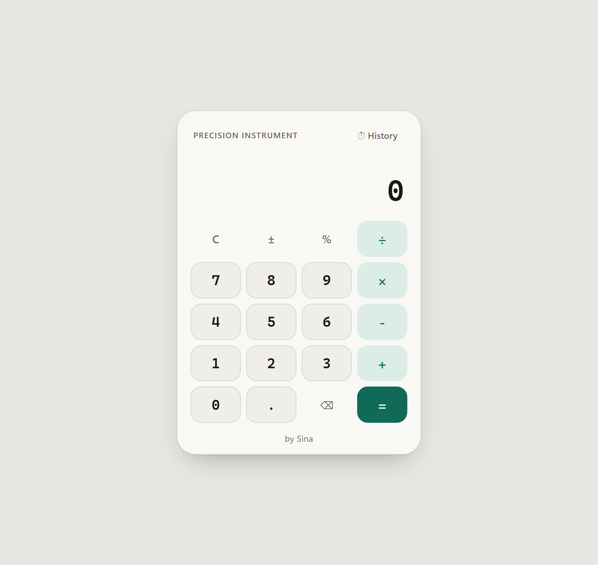
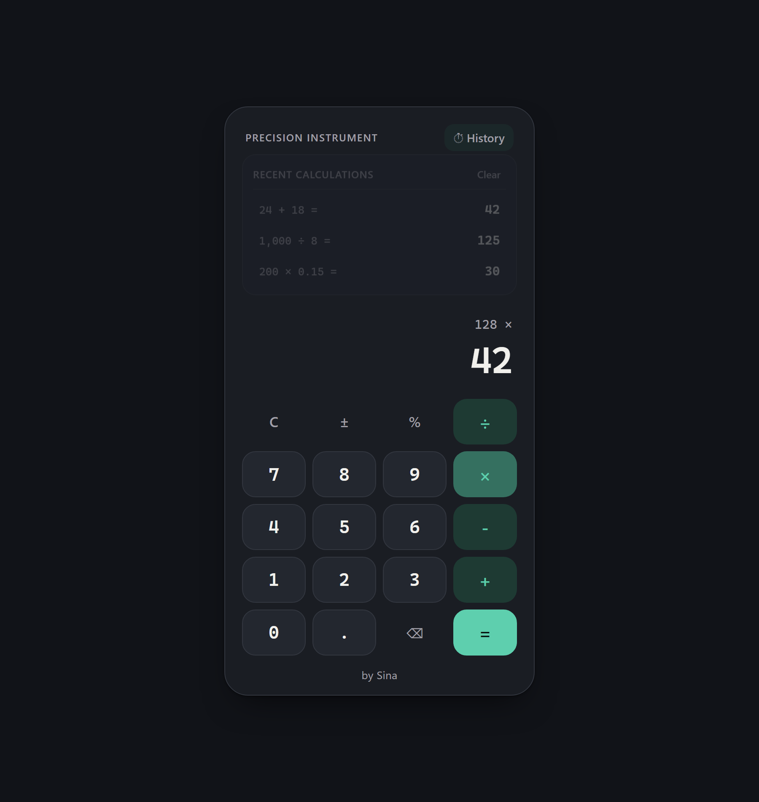
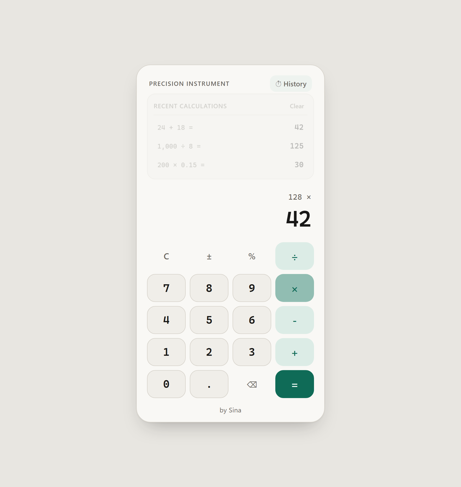

<div id="top"></div>

<!-- PROJECT HEADER -->
<div align="center">
  

  <h1>Precision Instrument Calculator</h1>

  <p>
    A sleek, tactile digital calculator engineered with vanilla JavaScript, modern SASS, and Swiss minimalist design principles. Features calculation history tape, automatic dark/light mode, active operator indicators, and zero external runtime dependencies.
  </p>

  <p>
    <a href="https://github.com/cenaei/Calculator/issues">Report Bug</a>
    ·
    <a href="https://github.com/cenaei/Calculator/issues">Request Feature</a>
  </p>

  <p>
    
    
    
    
    
  </p>
</div>

<br />

---

## Highlights & Features

<table>
  <tr>
    <td width="50%">
      <h3 align="center">🌙 Dark Mode</h3>
      
    </td>
    <td width="50%">
      <h3 align="center">☀️ Light Mode</h3>
      
    </td>
  </tr>
</table>

- **🎨 Modern Instrument Design System**: Built with token-driven SASS architecture, subtle tactile press physics, and automatic system theme detection (`prefers-color-scheme`).
- **⏱ Calculation History Tape**: Built-in collapsible history drawer (press `H` or click `⏱ History`) displaying chronological computations. **Click any past calculation result to immediately recall it into the active calculation.**
- **⚡ Active Operator Indicator**: Pending arithmetic operators (`+`, `-`, `×`, `÷`) illuminate with an active glow while you input the second operand.
- **⌨️ Complete Keyboard Synchronization**: Full keyboard control with visual button-press feedback (`.is-pressed`) corresponding to physical key presses.
- **🔢 Tabular Numerals**: Numeric displays use monospaced tabular numerals (`font-variant-numeric: tabular-nums`) to prevent layout shifting and digit jittering during calculation.
- **♿ First-Class Accessibility**: Screen-reader live regions (`aria-live="polite"`), high-contrast focus rings (`:focus-visible`), descriptive ARIA labels, and reduced-motion fallback (`prefers-reduced-motion`).
- **🚀 Zero Dependencies & Zero Build Step**: Runs directly in any modern browser by opening `index.html`.

---

## Keyboard Controls

| Key | Action |
| :--- | :--- |
| `0` – `9` | Append digit |
| `.` | Append decimal point |
| `+`, `-`, `*`, `/` | Arithmetic operations (`+`, `-`, `×`, `÷`) |
| `Enter` or `=` | Compute result |
| `Backspace` | Delete last entered digit |
| `Escape` or `Delete` | Clear all (`C`) |
| `H` or `h` | Toggle calculation history drawer |

---

## Getting Started

### Direct Run
No package manager or build step is required:
1. Clone the repository:
   ```bash
   git clone https://github.com/cenaei/Calculator.git
   cd Calculator
   ```
2. Open `index.html` directly in your browser:
   ```bash
   # On Windows (PowerShell)
   Start-Process index.html

   # On macOS
   open index.html

   # On Linux
   xdg-open index.html
   ```

### Modifying Styles (SASS)
Styles are written in modular SASS under `assets/sass/` and compiled to `assets/css/main.css`.

To recompile SASS after changes:
```bash
npx sass assets/sass/main.sass assets/css/main.css
```

Or watch for changes in development:
```bash
npx sass --watch assets/sass/main.sass assets/css/main.css
```

---

## Architecture & Project Structure

```
Calculator/
├── index.html                 # Semantic HTML markup and accessibility scaffolding
├── app.js                     # Calculator engine and UI event dispatcher
├── Screenshot.png             # Hero dark mode preview with history
├── screenshot-light.png       # Light mode preview with history
├── screenshot-dark.png        # Minimal dark mode preview
├── GLOSSARY.md                # Domain ubiquitous language definitions
├── assets/
│   ├── css/
│   │   ├── main.css           # Compiled production stylesheet
│   │   └── main.css.map       # SASS source map
│   └── sass/
│       ├── main.sass          # Root SASS stylesheet
│       ├── base/              # Resets, design tokens, and CSS variables
│       ├── layouts/           # Display, toolbar, history panel, and button grids
│       └── sass-utils/        # Colors, fonts, variables, and mixins
└── .scratch/                  # Feature specs and tracer-bullet tickets
```

---

## Author

**Sina Sangiji**
- GitHub: [@cenaei](https://github.com/cenaei)
- Email: [sina.sangiji@gmail.com](mailto:sina.sangiji@gmail.com)

---

## Acknowledgments
- Inspired by classic Braun and Teenage Engineering instrument design.
- UI/UX intelligence modeled with Swiss minimalism principles.

<p align="right">(<a href="#top">back to top</a>)</p>
